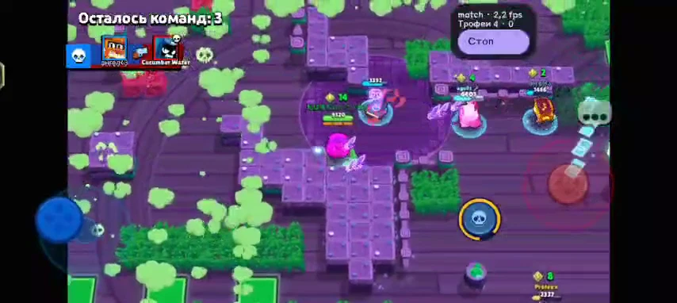
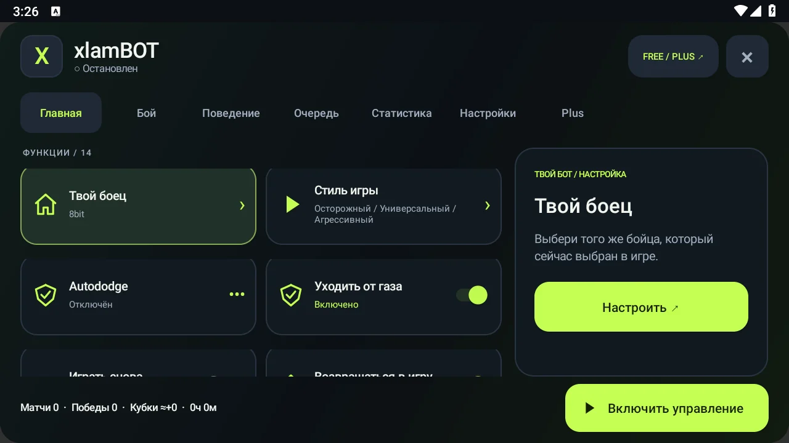

<div align="center">

# xlamBOT — бот для Brawl Stars на Android

**Выбирай бойца. Задавай стиль. Смотри результат.**

Бесплатный Android APK: распознавание экрана, движение, атаки, три стиля игры и очередь бойцов.

[](https://olegu621.github.io/xlamBOT-Android--Brawl-Stars--/compatibility/)
[](https://github.com/Olegu621/xlamBOT-Android--Brawl-Stars--/releases/latest/download/xlamBOT.apk)
[](https://t.me/xlamModz)
[](https://github.com/Olegu621/xlamBOT-Android--Brawl-Stars--/actions/workflows/website.yml)

[**Скачать APK →**](https://olegu621.github.io/xlamBOT-Android--Brawl-Stars--/#download) · [Установка](https://olegu621.github.io/xlamBOT-Android--Brawl-Stars--/install/) · [English](README.en.md)

[](https://olegu621.github.io/xlamBOT-Android--Brawl-Stars--/watch/)

**[▶ Смотреть 17 секунд реальной игры](https://olegu621.github.io/xlamBOT-Android--Brawl-Stars--/watch/)**

</div>

Видео показывает движение и атаки с работающей панелью. Это отдельная запись, а не обещание такого же результата в каждом матче. Игра остаётся видимой; root и постоянно подключённый ПК не нужны.

## Актуальная версия: 1.2.6

Бот сначала запускает распознавание на CPU, затем отдельно проверяет необязательное ускорение GPU/NNAPI после начала игры. Если подготовка не закончилась за 10 секунд, работа продолжается на CPU. Стоп не ждёт драйвер; повторный запуск не создаёт очередь подготовок. Сохранены исправления распознавания и движения из 1.2.5.

Проверки: 290 автоматических тестов, сборка, 5 проверок защиты и прежняя подпись. Полная игровая проверка сборки 1.2.6 пока не завершена.

[Что изменилось](https://olegu621.github.io/xlamBOT-Android--Brawl-Stars--/updates/#v126) · [Видео, скриншоты и материалы для публикаций](https://olegu621.github.io/xlamBOT-Android--Brawl-Stars--/media/)

[▶ Запись настоящего матча на 1.2.5 — вертикальный ролик без музыки](docs/assets/promo-125.mp4)

Сохранено из 1.2.2:

**Винс / Vince** добавлен в каталог и очередь: портрет, профиль дальней атаки и Супера, поиск по русскому и английскому имени. Всего **108 профилей**. На аккаунте разработчика Винс не разблокирован, поэтому матч за него пока не проверен. Отдельное распознавание гусениц и мотыльков не заявлено. [Каталог бойцов](https://olegu621.github.io/xlamBOT-Android--Brawl-Stars--/brawlers/).

Исправлен выбор бойца со скином: после открытия выбранной карточки бот нажимает SELECT без сверки названия скина.

Сохранены новая панель 1.2, бесплатная смена после +N кубков и исправления 1.2.1: автовозврат с рабочего стола, пауза в других приложениях и корректный учёт активности в онлайне. [История версий](https://olegu621.github.io/xlamBOT-Android--Brawl-Stars--/updates/).

[](https://olegu621.github.io/xlamBOT-Android--Brawl-Stars--/guide-panel/)

## Начать за пять шагов

1. [Скачай APK](https://github.com/Olegu621/xlamBOT-Android--Brawl-Stars--/releases/latest/download/xlamBOT.apk). Обновляй поверх старой версии, сохраняя очередь, настройки и историю.
2. Включи службу **xlamBOT в специальных возможностях** и окно поверх игры.
3. Подключи изображение. Android 11+: снимки через специальные возможности; Android 8–10: системный захват. На поддерживаемых Android 14+ при трансляции можно выбрать одно приложение.
4. Для первого запуска: **English в игре, Trio Showdown, стандартные кнопки**. В xlamBOT выбери того же бойца и «Универсальный».
5. Открой обычный Brawl Stars и запусти бота. Проверь бой и переход к следующему матчу.

После обновления выключи и включи службу специальных возможностей; при необходимости переподключи изображение. [Полная инструкция](https://olegu621.github.io/xlamBOT-Android--Brawl-Stars--/guide-start/).

## Free и Plus

| Возможность | Free | Plus |
| --- | :---: | :---: |
| Движение, атаки, способности; Осторожный / Универсальный / Агрессивный | ✓ | ✓ |
| Обычный Autododge и уход от газа | ✓ | ✓ |
| Очередь, смена после матчей или чистого прироста +N кубков, статистика | ✓ | ✓ |
| Усиленный Autododge и AutoAim с упреждением | — | ✓ |
| Сидеть в кустах, атаковать ящики и собирать кубы усиления | — | ✓ |
| Быстрая реакция, GPU / NNAPI на поддерживаемых устройствах | — | ✓ |
| Редкие пины в спокойные моменты | — | ✓ |

**Plus — 50 Telegram Stars / 30 дней**, продление вручную, без автосписаний. Пробного периода нет. Каждые **5 новых подтверждённых друзей дают 10 дней Plus** пригласившему. Оформление, привязка телефона и рефералка — в [@xlambottt_bot](https://t.me/xlambottt_bot?start=plus). [Условия и инструкция](https://olegu621.github.io/xlamBOT-Android--Brawl-Stars--/guide-plus/).

Ускорение зависит от устройства и драйверов; при проблемах используется CPU. Работа в фоне и при заблокированном экране не поддерживается. Запуск Android-приложения не требует подписки на Telegram-канал.

## Найти ответ

| Что нужно | Куда перейти |
| --- | --- |
| Установка APK и первый запуск | [Пошаговая настройка](https://olegu621.github.io/xlamBOT-Android--Brawl-Stars--/install/) |
| «Доступ запрещён», захват одного приложения, нет картинки | [Разрешения и изображение](https://olegu621.github.io/xlamBOT-Android--Brawl-Stars--/guide-capture/) |
| unknown, нет движения, отключение или выбор бойца | [Ошибки и восстановление](https://olegu621.github.io/xlamBOT-Android--Brawl-Stars--/guide-errors/) |
| Винс, свой боец, очередь и смена после +N | [Каталог](https://olegu621.github.io/xlamBOT-Android--Brawl-Stars--/brawlers/) · [Очередь](https://olegu621.github.io/xlamBOT-Android--Brawl-Stars--/guide-queue/) |
| Проверенные устройства и известные жалобы | [Совместимость с Android](https://olegu621.github.io/xlamBOT-Android--Brawl-Stars--/compatibility/) |
| Все функции и настройки | [Руководство с поиском](https://olegu621.github.io/xlamBOT-Android--Brawl-Stars--/guide/) |

## Помоги проверить свой телефон

Нужны отчёты и об ошибках, и об успешной работе. [Создать отчёт](https://github.com/Olegu621/xlamBOT-Android--Brawl-Stars--/issues/new/choose) или написать в комментариях [@xlamModz](https://t.me/xlamModz):

```text
Модель телефона, Android и оболочка:
Версия xlamBOT и источник изображения:
Боец, режим и условие очереди:
Что работает / на каком шаге проблема:
Был ли переход к следующему матчу:
Видео и последние строки журнала, если есть:
```

Проверяй движение, атаки и следующий матч. Не публикуй токены, пароли и платёжные данные.

## О репозитории

Public **Brawl Stars bot for Android** downloads, release notes and documentation. Здесь публикуются APK и сайт GitHub Pages. Исходники Android-приложения, ключи подписи, модели и символы сбоев остаются приватными. Обновления устанавливаются вручную.

**Star** сохраняет проект в избранном; **Watch → Custom → Releases** подписывает на новые APK. [Предложить функцию](https://github.com/Olegu621/xlamBOT-Android--Brawl-Stars--/issues/new?template=feature.yml).

Проект Olegu621, не связан с Supercell. Игровые изображения и названия принадлежат правообладателям. [Сторонние компоненты](THIRD-PARTY-NOTICES.md).
