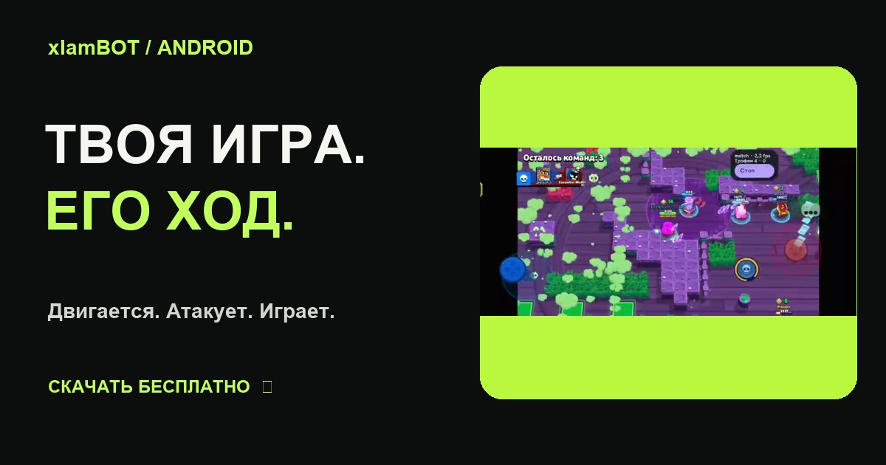

<div align="center">

# xlamBOT — Brawl Stars Bot for Android

**Бот для Brawl Stars: выбирай стиль, составляй очередь и следи за результатом.**

Free Android APK with screen recognition, touch controls, three play styles and brawler queues. [English guide](README.en.md).

[](https://olegu621.github.io/xlamBOT-Android--Brawl-Stars--/)
[](https://github.com/Olegu621/xlamBOT-Android--Brawl-Stars--/releases/download/v1.1.5/xlamBOT.apk)
[](https://t.me/xlamModz)
[](https://github.com/Olegu621/xlamBOT-Android--Brawl-Stars--/actions/workflows/website.yml)

[**Скачать и настроить →**](https://olegu621.github.io/xlamBOT-Android--Brawl-Stars--/) · [Что нового](https://github.com/Olegu621/xlamBOT-Android--Brawl-Stars--/releases/tag/v1.1.5) · [Сообщить об ошибке](https://github.com/Olegu621/xlamBOT-Android--Brawl-Stars--/issues/new/choose)

</div>

[](https://olegu621.github.io/xlamBOT-Android--Brawl-Stars--/)

**[Сайт и скачивание](https://olegu621.github.io/xlamBOT-Android--Brawl-Stars--/)** · **[Установка](https://olegu621.github.io/xlamBOT-Android--Brawl-Stars--/install/)** · **[Все функции](https://olegu621.github.io/xlamBOT-Android--Brawl-Stars--/features/)** · **[Помощь](https://olegu621.github.io/xlamBOT-Android--Brawl-Stars--/help/)** · **[English](https://olegu621.github.io/xlamBOT-Android--Brawl-Stars--/en/)**

Посмотри [запись игры xlamBOT](https://olegu621.github.io/xlamBOT-Android--Brawl-Stars--/watch/) и [историю обновлений APK](https://olegu621.github.io/xlamBOT-Android--Brawl-Stars--/updates/).

## Полная документация

**[Открыть руководство с поиском →](https://olegu621.github.io/xlamBOT-Android--Brawl-Stars--/guide/)**

Десять подробных глав для версии 1.1.5: установка и первый запуск, панель и статусы, разрешения и изображение, бойцы и стили, очередь, настройки производительности, Plus, устранение ошибок, отчёты и данные, обновление. Есть примеры расчёта целей и +N, ссылки на каждый раздел и печать через браузер. Руководство читается с телефона и без JavaScript.

xlamBOT распознаёт экран Brawl Stars и управляет игрой касаниями прямо на Android. В Free входят движение, атаки, базовое уклонение, три стиля, очередь бойцов и статистика. Plus добавляет отдельные настройки боя; базовый APK бесплатен.

**Актуальная версия: 1.1.5.** Обновлены условия Plus: общая бесплатная акция до 22 октября 2026, 19:00 МСК, затем разовые 3 часа при первом подключении. Ранее выданные 72 часа и оплаченные сроки сохраняются. [Изменения релиза](https://github.com/Olegu621/xlamBOT-Android--Brawl-Stars--/releases/tag/v1.1.5).

## Начать играть

1. Скачай APK с сайта и установи поверх старой версии. История и настройки сохранятся.
2. Включи службу xlamBOT в специальных возможностях. После обновления выключи и включи её снова.
3. Подключи изображение игры, открой обычный Brawl Stars, выбери нужного бойца и запусти бота.

Для первого запуска рекомендуем English в игре, стандартное управление и Trio Showdown — на этом режиме проверен полный цикл матчей.

Android 11+: снимки через специальные возможности. Android 8–10: системный запрос захвата экрана. Root и постоянно подключённый компьютер не нужны.

Захват только игры: в версии **1.1.1+** выбери **Настройки → Получение изображения → Трансляция экрана**, заново подключи изображение и выбери **«Одно приложение» → Brawl Stars**. Нужна поддерживаемая прошивка Android 14+. [Подробнее](https://olegu621.github.io/xlamBOT-Android--Brawl-Stars--/#app-capture).

Если Android пишет «Доступ для приложения запрещён», смотри [инструкцию по ограниченным настройкам](https://olegu621.github.io/xlamBOT-Android--Brawl-Stars--/#restricted-settings).

## Free и Plus

| Возможность | Free | Plus |
| --- | :---: | :---: |
| Три стиля, движение, атаки, базовое уклонение | ✓ | ✓ |
| Очередь по целям и количеству матчей, статистика | ✓ | ✓ |
| Усиленное уклонение и аимбот с упреждением | — | ✓ |
| Прямой GPU / адаптивный NNAPI и режим 540p | — | ✓ |
| Кусты с выходом при опасности, атака ящиков | — | ✓ |
| Смена бойца после чистого прироста +N кубков | — | ✓ |
| Редкие пины в спокойные моменты | — | ✓ |

**Plus: 50 Telegram Stars / 30 дней, продление вручную.** Общая акция — бесплатно до 22.10.2026 19:00 МСК. После акции — 3 часа один раз при первом подключении Plus. Ранее выданные 72 часа сохраняются, автосписаний нет. Подключи телефон через **xlamBOT → Plus → Telegram**, активируй доступ в [боте](https://t.me/xlambottt_bot?start=plus), затем нажми «Обновить доступ». Нужна версия 1.1.0 или новее.

Ускорение выбирается после сравнения скорости и результатов распознавания. Прямой GPU работает через OpenCL/OpenGL; назначение NNAPI на NPU/GPU зависит от драйвера телефона. При ошибке или отсутствии выигрыша остаётся CPU. Снижение времени анализа не равно такому же росту FPS всей игры.

Для автовыбора создай «Мою очередь» и включи переключатель в Plus: +N считается от подтверждённого счётчика в начале текущего захода, включая потери в поражениях. Состояние сохраняется после перезапуска.

**Мини-апп Plus:** в личных сообщениях [@xlambottt_bot](https://t.me/xlambottt_bot?start=plus) отправь `/start` и нажми «Открыть xlamBOT · Plus». В нём доступны срок подписки, общая акция и пробные 3 часа, ручная покупка за Stars, история платежей, привязанный телефон и поддержка. [Подробная инструкция](https://olegu621.github.io/xlamBOT-Android--Brawl-Stars--/guide-plus/#miniapp).

## Помоги с совместимостью

Напиши в [комментариях Telegram](https://t.me/xlamModz) или [создай issue](https://github.com/Olegu621/xlamBOT-Android--Brawl-Stars--/issues/new/choose). Отзывы нужны и от тех, у кого всё работает.

```text
Телефон и процессор:
Android и оболочка:
Версия xlamBOT:
Источник изображения / CPU, GPU или NNAPI:
Боец и режим игры:
Работает нормально / что случилось:
Через сколько времени, как повторить:
Последние строки журнала и короткое видео:
```

Не публикуй токены, пароли и платёжные данные. Список проверенных устройств пополняется по воспроизводимым проверкам; отзыв об одном телефоне не гарантирует работу на всех прошивках.

## About this repository

xlamBOT is an Android Brawl Stars automation app with screen recognition, three play styles, brawler queues and statistics. Download the APK from Releases; setup and support are available on the website and Telegram. This public repository hosts downloads, documentation and GitHub Pages. Android application source code, signing keys, crash symbols and raw model files are private.

Обновление APK — вручную с сайта. Этот репозиторий не содержит автообновлятор.

Самостоятельный проект, не связанный с Supercell. Названия и игровые изображения принадлежат правообладателям. [Сторонние компоненты](THIRD-PARTY-NOTICES.md).

## Поддержать проект

Пользуешься xlamBOT? Поставь **Star**, чтобы сохранить репозиторий, и выбери **Watch → Custom → Releases**, чтобы узнавать о новых APK. Самая полезная помощь — воспроизводимый отчёт о проблеме или о телефоне, на котором всё работает. [Предложить функцию](https://github.com/Olegu621/xlamBOT-Android--Brawl-Stars--/issues/new?template=feature.yml).
